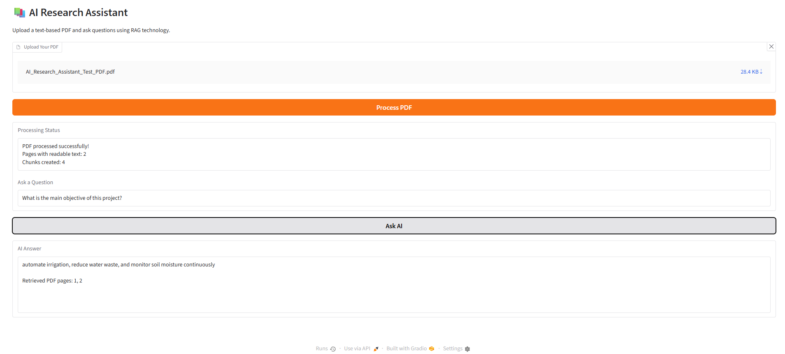

# 📚 AI Research Assistant — RAG-Based PDF Question Answering

An AI-powered research assistant that allows users to **upload PDF documents and ask questions about their content** using Retrieval-Augmented Generation (RAG).

The project combines Natural Language Processing (NLP), semantic search, vector embeddings, and a language model to retrieve relevant information and generate document-based answers through an interactive web interface.

## 🖥️ Application Screenshot



*AI Research Assistant processing a Smart Irrigation research PDF and answering a question using retrieved document information.*

## 🚀 Key Features

- 📄 **PDF Upload:** Upload text-based PDF documents directly through the web interface.
- 🔍 **Semantic Search:** Find relevant information using sentence embeddings.
- 🧠 **AI-Powered Answers:** Generate answers using FLAN-T5 Large.
- 📚 **Retrieval-Augmented Generation:** Combine FAISS retrieval with language model generation.
- 📍 **Page References:** Display the PDF pages from which relevant passages were retrieved.
- 🛡️ **Missing Information Handling:** Return "Not found in the PDF" when retrieved information does not meet the experimental similarity threshold or the model identifies missing information.
- ⚡ **Interactive Interface:** User-friendly application developed using Gradio.
- 🔄 **Document Processing:** Automatically extract, split, and index uploaded PDF text.
- 👤 **Session-Based Processing:** Keep processed documents in separate Gradio session states.

## 🛠️ Technologies Used

| Technology | Purpose |
|---|---|
| Python | Core application development |
| PyMuPDF | PDF text extraction |
| Sentence Transformers | Text embedding generation |
| all-MiniLM-L6-v2 | Semantic embedding model |
| FAISS | Vector similarity search |
| FLAN-T5 Large | AI answer generation |
| Hugging Face Transformers | Pretrained language model integration |
| PyTorch | Deep learning framework |
| NumPy | Numerical operations |
| Gradio | Interactive web interface |
| Google Colab | Development and testing environment |

## 🧠 How the System Works

The application follows a Retrieval-Augmented Generation pipeline.

**Step 1 — PDF Upload**

The user uploads a text-based PDF document through Gradio.

**Step 2 — Text Extraction**

PyMuPDF extracts readable text from each PDF page.

**Step 3 — Document Chunking**

The extracted text is divided into smaller, sentence-aware chunks.

**Step 4 — Embedding Generation**

The Sentence Transformer model (`all-MiniLM-L6-v2`) converts text chunks into numerical embeddings.

**Step 5 — FAISS Indexing**

The document embeddings are stored in a FAISS vector index for similarity search.

**Step 6 — Question Processing**

The user's question is converted into an embedding using the same Sentence Transformer model.

**Step 7 — Relevant Passage Retrieval**

FAISS retrieves the three most similar document chunks.

**Step 8 — Similarity Check**

The application checks the highest similarity score against an experimental threshold of 0.30.

**Step 9 — Answer Generation**

If the threshold is met, FLAN-T5 Large generates an answer using the retrieved PDF passages.

**Step 10 — Result Display**

The application displays the AI-generated answer and retrieved PDF page numbers.

## 💻 Installation and Setup

### 1. Clone the Repository

```bash
git clone https://github.com/YOUR_USERNAME/AI-Research-Assistant-RAG.git
cd AI-Research-Assistant-RAG
```

Replace `YOUR_USERNAME` with your actual GitHub username.

### 2. Install Dependencies

```bash
pip install -r requirements.txt
```

### 3. Run the Application

```bash
python app.py
```

### 4. Open the Web Interface

Once the models load, Gradio displays a local URL, typically:

```text
http://127.0.0.1:7860
```

Open the URL in your browser.

**System requirements:** FLAN-T5 Large requires substantial memory. A CUDA-compatible GPU is recommended for faster inference. Initial model downloads require an internet connection.

## 📖 How to Use

1. Open the AI Research Assistant interface.
2. Click **Upload Your PDF**.
3. Select a text-based PDF document.
4. Click **Process PDF**.
5. Wait for the processing confirmation.
6. Type a question in the **Ask a Question** field.
7. Click **Ask AI**.
8. Read the generated answer and retrieved page numbers.

## 🧪 Example Demonstration

**Test Document:** Smart Irrigation Research PDF

**Question:**

What is the main objective of this project?

**AI-generated answer:**

Automate irrigation, reduce water waste, and monitor soil moisture continuously.

**Retrieved PDF pages:** 1, 2

The application was also tested with a wildfire simulation research report involving Agent-Based Modeling, NetLogo, and MODIS satellite fire data.

## 📊 Testing and Results

The prototype was tested on two different research documents.

| Test | Observed result |
|---|---|
| PDF upload | Successful |
| PDF text extraction | Successful |
| Document chunking | Successful |
| FAISS retrieval | Retrieved relevant passages |
| Question answering | Generated relevant answers |
| Missing information | Correctly rejected tested unsupported questions |
| Gradio interface | Successfully launched |
| Standalone application | Successfully tested in a fresh Google Colab notebook |

These results demonstrate basic end-to-end functionality. They do not constitute a comprehensive benchmark of retrieval accuracy or answer reliability.

## ⚠️ Current Limitations

- Scanned or image-only PDFs require OCR, which is not currently implemented.
- Answers may be short, incomplete, or occasionally inaccurate.
- The similarity threshold of 0.30 is experimental and may reject valid questions or accept irrelevant passages.
- Displayed page numbers identify retrieved passages rather than verified citations for individual claims.
- Large documents may require more memory and improved chunking.
- The FLAN-T5 Large model can be slow on CPU.
- The application processes one PDF per user session at a time.

## 🔮 Future Improvements

- Add OCR support for scanned PDFs.
- Improve answer completeness using stronger language models.
- Introduce better reranking and retrieval strategies.
- Add verified source citations and highlighted supporting passages.
- Support multiple PDF uploads within one session.
- Add conversation history and follow-up questions.
- Improve handling of large research documents.
- Deploy the application for persistent online access.

## 📌 Project Status

**Working prototype — successfully tested using Google Colab and Gradio.**

This project demonstrates practical experience with:

- Natural Language Processing (NLP)
- Retrieval-Augmented Generation (RAG)
- Sentence Embeddings
- Vector Databases and Semantic Search
- Hugging Face Language Models
- AI Application Development
- Interactive Web Interfaces

## ⭐ Project Overview

This AI Research Assistant was developed as a hands-on project to explore how modern NLP and deep learning technologies can make information retrieval from PDF documents more accessible.

The project demonstrates the integration of pretrained AI models with a document retrieval pipeline to build a functional question-answering application.
